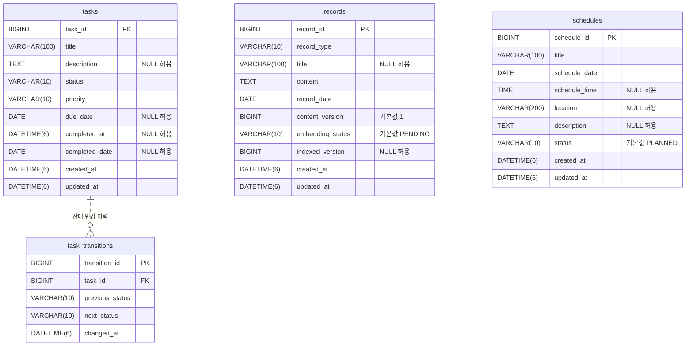

# 나의 하루 데이터베이스 ERD

현재 구현된 MySQL 업무 테이블 4개를 Flyway V1~V3 마이그레이션 기준으로 정리했다.

모든 PK는 자동 증가한다. `NULL 허용` 표시가 없는 컬럼은 필수다.

## 테이블과 관계

| 테이블 | 저장 내용 | 주요 규칙 |
|---|---|---|
| `records` | 빠른 메모와 일기 원문 | `record_type`은 `MEMO` 또는 `DIARY`. 제목·본문·날짜 변경 시 `content_version`을 올리고 `embedding_status`를 `PENDING`으로 바꾼다. |
| `schedules` | 날짜와 시간에 맞춰 잡은 약속 | 상태는 `PLANNED`, `COMPLETED`, `CANCELLED`. 시간·장소·메모는 선택이다. |
| `tasks` | 마감일과 진행 상태를 관리하는 할 일 | 상태는 `TODO`, `DOING`, `DONE`, 우선순위는 `LOW`, `NORMAL`, `HIGH`. `DONE`이면 두 완료 컬럼이 모두 필수이고 다른 상태에서는 둘 다 NULL이다. `completed_date`는 서울 기준 완료 날짜다. |
| `task_transitions` | 할 일의 이전 상태, 다음 상태, 변경 시각 | 이력마다 할 일 1건을 참조한다. 할 일 1건에는 이력이 0건 이상 붙으며, 할 일을 삭제하면 이력도 `ON DELETE CASCADE`로 삭제된다. |

캘린더는 독립 테이블인 `records`, `schedules`, `tasks`의 `record_date`, `schedule_date`, `due_date`를 기준으로 조회 결과를 날짜별로 합쳐 보여준다. AI 검색 인덱스 연동은 6단계 개발 범위이며, 현재 `records`에 원문 버전과 인덱스 상태 컬럼이 마련되어 있다.

## 마이그레이션

- [V1 — 기록](../backend/src/main/resources/db/migration/V1__create_records.sql)
- [V2 — 약속](../backend/src/main/resources/db/migration/V2__create_schedules.sql)
- [V3 — 할 일과 상태 변경 이력](../backend/src/main/resources/db/migration/V3__create_tasks.sql)
