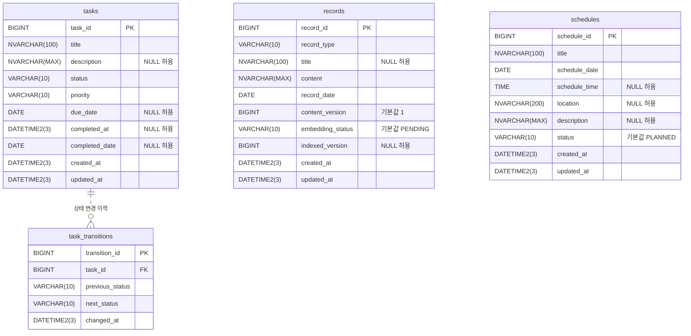

# 나의 하루 데이터베이스 ERD

SQL Server Express의 업무 테이블 4개를 초기 스키마 기준으로 정리했다.

모든 PK는 자동 증가한다. `NULL 허용` 표시가 없는 컬럼은 필수다.

## 테이블과 관계

| 테이블 | 저장 내용 | 주요 규칙 |
|---|---|---|
| `records` | 빠른 메모와 일기 원문 | `record_type`은 `MEMO` 또는 `DIARY`. 제목·본문·날짜 변경 시 `content_version`을 올리고 `embedding_status`를 `PENDING`으로 바꾼다. |
| `schedules` | 날짜와 시간에 맞춰 잡은 약속 | 상태는 `PLANNED`, `COMPLETED`, `CANCELLED`. 시간·장소·메모는 선택이다. |
| `tasks` | 마감일과 진행 상태를 관리하는 할 일 | 상태는 `TODO`, `DOING`, `DONE`, 우선순위는 `LOW`, `NORMAL`, `HIGH`. `DONE`이면 두 완료 컬럼이 모두 필수이고 다른 상태에서는 둘 다 NULL이다. `completed_date`는 서울 기준 완료 날짜다. |
| `task_transitions` | 할 일의 이전 상태, 다음 상태, 변경 시각 | 이력마다 할 일 1건을 참조한다. 할 일 1건에는 이력이 0건 이상 붙으며, 할 일을 삭제하면 이력도 `ON DELETE CASCADE`로 삭제된다. |

캘린더는 독립 테이블인 `records`, `schedules`, `tasks`의 `record_date`, `schedule_date`, `due_date`를 기준으로 조회 결과를 날짜별로 합쳐 보여준다. `records`에는 원문 버전과 인덱스 상태 컬럼이 있다. SQL Server가 원본 저장소이며 Qdrant는 향후 재생성 가능한 인덱스로 사용한다.

날짜 컬럼은 날짜 자체를 저장하고 생성·수정 시각은 UTC로 저장한다. 한글 원문과 제목은 NVARCHAR로 저장한다.

## 초기 스키마

백엔드가 최초 연결에서 [schema.sql](../backend-next/schema.sql)을 적용한다. 기존 데이터가 있는 SQL Server DB의 변경에는 별도 마이그레이션을 작성한다.

## t&tech 팀 데이터

- [팀 접근](../backend-next/team-schema.sql)은 팀원, 세션과 일회용 초대를 저장한다. 세션과 초대 링크의 토큰은 해시로 저장한다.
- [팀 업무](../backend-next/team-work.sql)는 시작일·마감일, 등록자·현재 담당자, 상태와 원본 견적을 연결한다.
- [주간보고](../backend-next/team-reports.sql)는 월요일·작성자·보고 종류를 키로 사용한다. 개인 보고를 제출하면 당시 완료·예정 업무를 함께 저장한다.
- [조직](../backend-next/db.mjs)의 `teams`는 팀 이름·유형(SALES 기술·DEV 개발·TECH 연구·SUPPORT 경영, 괄호는 화면 표기)·근무지·정렬 순서를 저장하고, 처음 실행할 때 7개 팀을 넣는다. `team_users.role`은 LEAD·MEMBER이고 모든 사용자가 `team_id`를 가진다. 관리자는 `is_admin` 권한이고, 직급은 `title`(대표·본부장·팀장·프로)이다. 팀장은 팀마다 1명(필터 고유 인덱스 `team_lead_per_team`)이다. 예전 ADMIN 역할 계정은 마이그레이션에서 기술영업 1팀 소속 관리자로 바뀌고, 관리자가 없으면 기존 팀장에게 관리자 권한을 준다. 대표·본부장은 필터 고유 인덱스(`team_users_unique_title`)로 회사 전체에 각각 1명이다. 팀장 직급은 팀장 권한(LEAD)과 같고, 필터 고유 인덱스(`team_users_one_lead_title`)로 부서마다 1명이다.
- 팀 업무는 `team_id`(팀 업무) 또는 `personal_owner_id`(개인 업무) 중 하나만 가진다. 회의 보고서 키는 (`team_id`, 날짜, 종류)이고, 주간보고·초대도 `team_id`를 저장한다. 초대는 역할(LEAD·MEMBER)을 함께 저장한다.
- 조직 구조 이전의 단일 팀 데이터(사용자·팀 업무·회의·보고서·초대)는 마이그레이션에서 기술영업 1팀으로 옮긴다.
